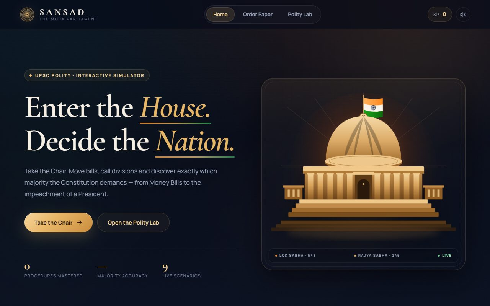

# Sansad — The Mock Parliament

An interactive UPSC Polity simulator where you take the Chair and run the Indian Parliament. Move bills, call divisions, and discover exactly which majority the Constitution demands — from a Money Bill to the impeachment of a President.

**Live site:** https://ajeet-iitk.github.io/IndianParliament/



## What you can do

- **Nine parliamentary scenarios**
  - Ordinary Bill
  - Money Bill
  - Finance Bill
  - Constitutional Amendment
  - No-Confidence Motion
  - Impeachment of the President
  - Removal of the Vice-President
  - Removal of the Speaker
  - Removal of a Judge
- **Play as the Presiding Officer** — every scenario runs as a sequence of procedural decisions, each with a constitutional citation and an explanation.
- **Choose the voting method** — voice vote, division, electronic voting, secret ballot, or ballot, with the correct method taught in context.
- **Pick the majority** — simple, effective, absolute, special majority (with and without state ratification), and the special majority · dual test used for judge removal.
- **Watch the House vote** — an animated 543-seat Lok Sabha, 245-seat Rajya Sabha, or 788-seat joint sitting hemicycle counts the ayes and noes live.
- **Score and progress** — 3-star accuracy tiers, XP, streaks, best scores and completed scenarios saved in `localStorage`.
- **Polity Lab** — a built-in reference for the two Houses, majority types, voting methods, and the legislative route of each bill type.
- **Responsive and cinematic** — custom SVG Parliament artwork, dark navy/sandstone/gold theme, serif display type, and a mobile bottom dock.

## Run locally

No build step and no dependencies. Open `index.html` in a browser, or serve the folder:

```bash
python -m http.server 8000
# then visit http://localhost:8000
```

## Deploy

The site is plain static HTML/CSS/JS and is published with GitHub Pages from the `main` branch root.

To publish your own copy:

1. Push the folder to a GitHub repository.
2. Go to **Settings → Pages**.
3. Set **Source** to *Deploy from a branch*, branch `main`, folder `/ (root)`.
4. Open `https://<username>.github.io/<repository>/`.

## Project structure

```
IndianParliament/
├── index.html              # Page shell, screens, hero SVG, mobile dock
├── assets/
│   ├── css/style.css       # Theme, layout, animations, responsive rules
│   └── js/
│       ├── data.js         # Scenarios, majority types, voting methods, Polity Lab
│       └── app.js          # Navigation, chamber rendering, game engine, scoring
└── shots/                  # Development screenshots (not required to run)
```

## Notes on accuracy

The simulator is written for exam revision and follows the constitutional provisions it cites, including:

- Money Bills: introduced only in the Lok Sabha, with the Rajya Sabha limited to 14 days and recommendations only (Art. 109–110).
- Ordinary Bills: deadlock resolved by a joint sitting under Art. 108.
- Constitutional Amendments: the Art. 368 route, including state ratification where required.
- President's impeachment: charge by one House, investigation by the other, two-thirds of the total membership of the investigating House (Art. 61).
- Vice-President's removal: Rajya Sabha initiates, Lok Sabha concurs, effective majority (Art. 67(b)).
- Speaker's removal: Lok Sabha only, effective majority; the Speaker may speak and vote in the first instance but cannot exercise a casting vote on their own removal (Art. 94, 96).
- Judge removal: special majority of each House plus the addresses procedure (Art. 124(4)–(5)).

This is an educational simulation, not an official source. For the authoritative text, consult the Constitution of India and the Rules of Procedure of the two Houses.

## License

Free for personal study and classroom use.
